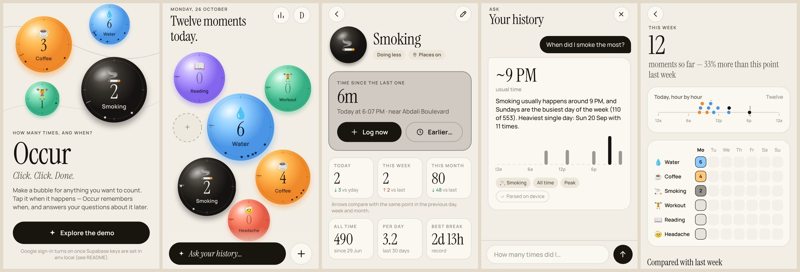
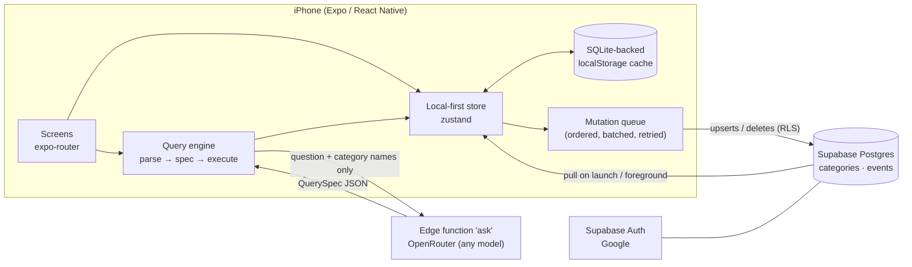

# Occur

**How many times, and when?** — a one‑tap life counter for iPhone.

Make a bubble for anything you want to count (coffee, cigarettes, headaches, push‑ups…). Tap it when it happens. Occur records the exact time (and, if you want, where), shows you patterns, and answers questions like *“How many times did I smoke in the last 30 days?”* or *“When do I drink coffee the most?”*

*Click. Click. Done.*



> Screens above are from the web preview of the built‑in demo mode; the app targets iOS.

---

## Quick start

```bash
npm install
cp .env.example .env.local      # add your Supabase URL + publishable key (or leave empty for demo mode)
npx expo start                  # press i for the iOS simulator, or scan the QR code with Expo Go
```

Everything the app uses ships in Expo Go (SDK 58), so no custom native build is needed to try it.
`npm test` runs the query-engine tests, `npm run typecheck` and `npm run lint` check the code.

**No backend yet?** Tap **Try it without an account** (always available, even with Supabase configured): the app runs fully on the device with four months of realistic sample data — no sign-in, no network — so every screen (and the Ask feature, via the on-device parser) can be tried immediately.

### Backend setup (Supabase, ~10 minutes)

1. **Create a project** at [supabase.com](https://supabase.com) and copy the project URL and *publishable* key into `.env.local`.
2. **Create the schema** — either run `supabase/migrations/20261026000000_init.sql` in the SQL editor, or:
   ```bash
   supabase link --project-ref <your-ref>
   supabase db push
   ```
3. **Google sign‑in**
   - Google Cloud Console → *Credentials* → create an **OAuth client ID (Web application)**. Authorised redirect URI: `https://<your-ref>.supabase.co/auth/v1/callback`.
   - Supabase → *Authentication → Providers → Google*: enable, paste the client ID and secret.
   - Supabase → *Authentication → URL Configuration → Redirect URLs*: add `occur://auth/callback` (dev/production builds) and `exp://**` (Expo Go).
4. **AI questions (OpenRouter):** create a key at [openrouter.ai](https://openrouter.ai/keys), then deploy the `ask` edge function. Either:
   - **Dashboard (no CLI):** *Edge Functions → Deploy a new function → Via editor*, name it `ask`, paste `supabase/functions/ask/index.ts`, deploy. Then *Edge Functions → Secrets* → add `OPENROUTER_API_KEY`.
   - **CLI:**
     ```bash
     npx supabase login
     npx supabase link --project-ref <your-ref>
     npx supabase secrets set OPENROUTER_API_KEY=sk-or-...
     npx supabase functions deploy ask --use-api
     ```
   Optional secret `LLM_MODEL` picks any OpenRouter model (default `google/gemini-3.6-flash`).
   If the function isn't deployed, Ask still works using the on‑device parser.

---

## What I built, and why

### The interface

- **Bubbles that are also clocks.** Each bubble shows today’s count, and its rim is a 24‑hour dial (midnight at the top) with a dot for every time you logged it today plus a faint “now” hand. The home screen answers *how many* **and** *when* without opening anything.
- **Frequent things are bigger and central.** Bubbles are circle‑packed; size comes from the last 14 days of use. That weight deliberately **excludes today**, so bubbles never grow or move under your finger while you tap. The layout settles once a day.
- **Tap = add one, hold = details.** A tap gives a haptic, a squish, a ripple and a floating “+1”, and shows a big **Undo** bar for 8 seconds.
- **Mistakes are one gesture away.** Every bubble with a count today has a **−** button on its rim, and a swipe down on the bubble also takes one away (“−1”, with Undo). The detail screen has a *Take one away* button too.
- **Two home styles.** Bubbles (default) or a plain **List** with big − / + buttons per row, switchable in Settings — for people who prefer buttons over gestures.
- **Nothing hidden.** Header buttons carry text labels (Insights, Settings), every screen has a labelled *Back* / *Close* / *Cancel*, pushed screens swipe back from anywhere, and a short tips card explains tap / − / hold until you’ve logged a few dozen entries.
- **Ideas never disappear.** First run shows a still grid of starter ideas (one tap each) plus *Make my own*. Afterwards the **+** opens the same grid (tap several, tap again to take one off), and while you have fewer than four bubbles a *More ideas* strip stays on the home screen.
- **A goal per bubble: just count / do more / do less.** More coffee isn’t “good” and more reading isn’t “bad”, so comparisons are coloured by the goal. “Do less” bubbles show a live *time since the last one* and the longest break instead of a streak.
- **Fair comparisons.** “This week vs last week” on a Monday morning compares against *last Monday morning*, not a whole week, everywhere in the app.
- **Back‑dating and fixing.** *Earlier…* logs something that already happened (with presets like “1 hour ago”). Tapping any time in the history lets you move or delete that entry.
- **Look and feel:** warm paper, black ink pills, soft 3D gradient bubbles, one rounded, highly legible family (Nunito) with large default text sizes. Light / Dark / Automatic chosen in Settings, Liquid Glass on iOS 26 for the + button, and Reduce Motion is respected.

### Screens

| Screen | What’s on it |
|---|---|
| Sign in | Google (Supabase OAuth in the iOS auth sheet), or try it without an account (local demo with sample data) |
| Home | Bubble field (or list), today’s total, tips, − buttons, Ask bar, + button, undo bar, sync indicator |
| Add | Grid of one-tap ideas, *Make my own*, Done |
| Bubble detail | Live time since last, today/week/month with fair deltas, all‑time, per‑day, streak or best break, 24h radial “when” chart, weekday bars, 15‑week calendar heatmap, full history grouped by day |
| New / edit bubble | Live preview, name, suggestions, emoji grid (or any emoji), colour, goal, “remember where” |
| Log earlier | Quick presets + date/time picker; also used to move an existing entry |
| Ask | Chat‑style questions with answer cards: headline number, sentence, mini chart, and chips showing how the question was understood |
| Insights | Week at a glance: today as a timeline, a category × weekday table, comparisons with last week, daily rhythm |
| Settings | Account, appearance (Automatic / Light / Dark), home style (Bubbles / List), sync status, CSV export, delete all data, sign out / leave demo |

---

## Architecture



### Stack

- **App:** Expo SDK 58, React Native 0.88, TypeScript (strict), expo‑router, React Compiler, Reanimated 4, react‑native‑svg (all bubbles and charts are hand‑drawn SVG, no chart library).
- **Backend:** Supabase: Postgres with Row Level Security, Auth (Google), and one Deno edge function.
- **Why Supabase:** real Postgres (the data is relational and time‑series shaped), RLS so the client can talk to the database directly and safely, Google auth and edge functions in one place, and a free tier reviewers can use.

### Data model

```
categories (id uuid, user_id, name, emoji, color, goal 'track'|'more'|'less', track_location, created_at, updated_at)
events     (id uuid, user_id, category_id → categories ON DELETE CASCADE,
            occurred_at timestamptz, tz text, latitude, longitude, place, note,
            source 'tap'|'manual'|'import', created_at, updated_at)
```

- Every row is owned by `auth.uid()`; RLS policies cover select, insert, update and delete, and an event can only point at one of the caller’s own categories.
- `tz` stores the IANA zone the phone was in, so “what hour do I usually…” stays right after travel.
- Indexes on `(user_id, occurred_at desc)` and `(category_id, occurred_at desc)`.
- `category_summary(tz)` returns today, week, month, all‑time and last event per category straight from SQL, for future widgets or server use.

### Local‑first logging (the “Click. Click. Done.” part)

Tapping must never wait for the network:

1. The app creates the event with a **client‑generated UUID** and puts it in the in‑memory store immediately.
2. It appends a mutation to a **persistent queue** (stored with the cache in SQLite‑backed `localStorage`).
3. A sync loop replays the queue **in order**, batching runs of event writes (up to 200 per request). Because IDs come from the client, every write is an idempotent **upsert**, so retries can’t create duplicates.
4. Errors are sorted: network failures back off exponentially (2s → 60s) and retry; Postgres or RLS errors drop just that item so one bad write can’t block the queue.
5. Edits to a row that hasn’t been sent yet are merged, and deleting something that was never sent cancels it locally.
6. On launch and on returning to the foreground: flush, then pull a fresh snapshot, with any still‑pending local changes re‑applied on top.

Location capture works the same way: the tap is saved first, then a recent cached GPS fix (or a balanced‑accuracy one) and a reverse‑geocoded place name are added in the background. Coordinates are rounded to about 11 m.

### Natural‑language questions (how AI is used)

The model **translates the question; it never answers it.**

```
"When did I smoke the most?"
   │
   ├─▶ edge function → LLM (temperature 0, JSON mode)
   │     input:  the question + category ids/names + today's date + time zone
   │     output: QuerySpec  { intent: "peak", categoryIds: ["…smoking"], range: { preset: "all_time" } }
   │
   ├─▶ sanitizeSpec(): validate the shape, drop unknown category ids, reject anything unusable
   │     (falls back to the on-device rule parser on timeout/error/invalid output)
   │
   └─▶ executeQuery(): deterministic TypeScript over the local event log
         → "~9 PM — Smoking usually happens around 9 PM, and Sundays are the busiest day…"
```

- **Exact numbers.** Every count, average and date comes from code, so the model can’t hallucinate statistics.
- **Privacy.** The model only sees the question and the names of your bubbles, never your history, times or locations.
- **Transparent.** Each answer shows chips for what it understood (category, range, intent) and whether the AI or the on‑device parser read the question.
- **Resilient.** A rule‑based parser (synonyms like *cigarettes → Smoking* and *latte → Coffee*, ranges like “last 30 days”, “in March”, “on weekends”, “after 10pm”) answers instantly offline and covers the common questions without any API key.
- **Safe with untrusted input.** Category names go into the prompt as quoted data with an instruction to treat them as labels, the request is size‑capped, and the output is validated.
- **The query language** (`src/lib/query/types.ts`) has ten intents: count, peak (by hour, weekday, day, week, month, or all of them), last, first, average (per day, week, month), compare, streak, gap, list and ranking. Each takes a time range and optional weekday or hour filters. Comparisons for the current period are clipped to the same elapsed point.

### Project layout

```
src/
  app/                    expo-router screens
    _layout.tsx           fonts, auth guard (Stack.Protected), data wiring
    index.tsx             home: bubble field or list, ask bar, undo
    add.tsx               one-tap ideas grid
    category/[id].tsx     detail, charts, history
    edit-category.tsx     create / edit / delete
    log-time.tsx          back-date or move an entry (form sheet)
    ask.tsx               natural-language questions
    insights.tsx          week overview
    settings.tsx          account, appearance, home style, sync, export, delete
    sign-in.tsx
  components/             Bubble (SVG clock bubble), TapBubble (gestures + animation), charts, buttons, icons
  lib/
    store.ts              local-first store + sync engine
    prefs.ts              device preferences (theme, home style)
    auth.ts               Google OAuth (PKCE) and the local demo mode
    stats.ts / time.ts    pure date & statistics helpers
    packing.ts            circle packing for the home screen
    query/                types · parse-local · sanitize · resolve · execute · ask
    demo.ts               deterministic sample data
  theme/                  colour tokens, typography, bubble palette
supabase/
  migrations/             schema, RLS, triggers, summary function
  functions/ask/          edge function (single file): prompt, validation, OpenRouter call
tests/query.test.ts       parser, executor, sanitizer and stats tests
```

### Testing

`npm test` runs 15 tests on the parts that must be exactly right: the two example questions from the brief, synonyms, ranges and filters, exact counts against a generated log, peak hour and weekday, “last time”, fair week‑vs‑week comparison, ranking, rejecting invented category ids from a model, period stats, streaks and gaps. Typecheck and lint pass.

---

## Trade‑offs and what I’d do next

- **Full history on the device.** The app syncs the whole event log so stats and queries are instant and work offline. That’s fine for years of personal logging (tens of thousands of rows). Beyond that I’d switch to an incremental pull (`updated_at > last_sync`, which the schema already supports) and run heavy aggregates in SQL (`category_summary` is the start of that).
- **Sync conflicts** are last‑write‑wins per row, which is right for a single person on one or two devices. Deletes made on another device show up on the next full pull. Supabase Realtime would make that live.
- **Native Google Sign‑In:** the browser‑sheet OAuth flow works in Expo Go and in production. The native Google SDK would feel slightly smoother but needs a dev build.
- **Next:** Home Screen widget and Lock Screen / Control Center buttons (logging without opening the app), Siri/App Intents (“log a coffee”), reminders for “do more” goals, Apple Health import for things like workouts, a map of where things happen, and an AI weekly summary built on the same spec engine.

## Notes

- The edge function’s JWT verification is on, so only signed‑in users can call it. The demo never calls it and answers questions on‑device.
- `src/app/explore.tsx` only redirects. It’s left over from the Expo template and can be deleted.
